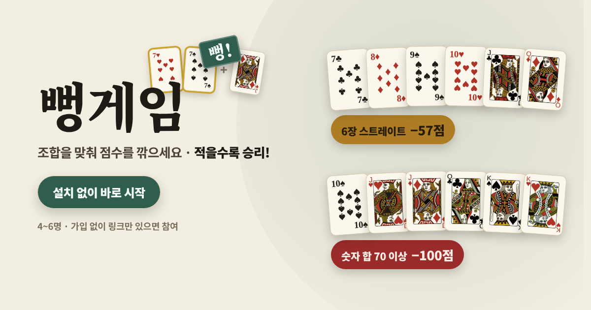

# 뻥게임

**조합을 맞춰 점수를 깎는 카드 게임 · 점수가 적을수록 승리**

### ▶︎ [지금 바로 플레이하기](https://woong0796-cell.github.io/bbeong/)

설치도, 가입도, 앱 다운로드도 없습니다. 링크만 누르면 바로 시작합니다.

---

## 어떤 게임인가요

카드 5장으로 시작해, **조합을 완성해서 손을 먼저 터는 사람이 마이너스 점수**를 가져갑니다.
13판을 치고 나서 누적 점수가 **가장 낮은 사람이 1등**입니다.

재미는 "내 차례"에만 있는 게 아닙니다. 남이 버린 카드에 **"뻥!"** 하고 내 카드를 얹어 버릴 수 있고,
짝을 들고 있으면 **"잡기"** 로 판을 통째로 끝내버릴 수도 있습니다. 내 차례만 기다리는 게임이 아닙니다.

| | |
|---|---|
| **인원** | 4~6명 (사람이 모자라면 봇이 채웁니다) |
| **한 게임** | 13판 |
| **준비물** | 링크 하나. 그게 전부입니다. |

## 친구들과 하는 법

1. 한 명이 위 링크를 열고 **［온라인 플레이］ → ［방 만들기］**
2. 화면에 뜨는 **6자리 방 코드**를 단톡방에 붙여넣기
3. 나머지 사람들은 같은 링크를 열고 **［코드로 참가］**

자리가 남으면 봇이 대신 앉습니다. 휴대폰·태블릿·PC 어디서든 됩니다.

## 혼자서도 됩니다

봇 4~5명과 바로 한 판. 난이도는 쉬움·보통·어려움 중에 고르면 됩니다.
**게임 안에 룰북이 들어 있습니다** — 카드 그림으로 조합을 설명해 두었으니, 처음이어도 읽으면서 하면 됩니다.

## 선택 규칙 (확장판)

시작 전에 하나씩 켜고 끌 수 있습니다.

- **조커카드** — 스트레이트의 빈자리를 메워 주지만, 남이 먼저 끝내면 +14점짜리 폭탄
- **땡큐카드** — 앞사람이 버린 카드를 가져와 그 자리에서 판을 끝내기
- **배판** — 직전 판 꼴찌가 다음 한 판의 점수를 2배로 거는 선언 (게임당 1인 1회)

---

카드 그림은 퍼블릭 도메인 자료(Byron Knoll, *Vector Playing Cards*)를 바탕으로 다시 그렸습니다. 
게임 디자인·코드·화면 © 2026 정재웅

